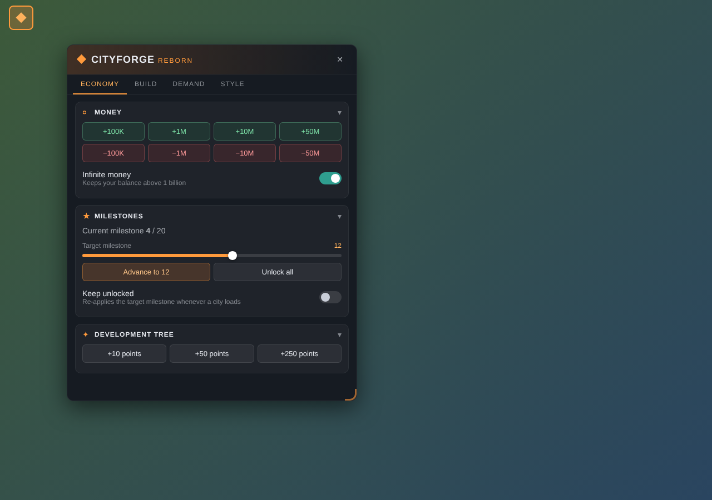
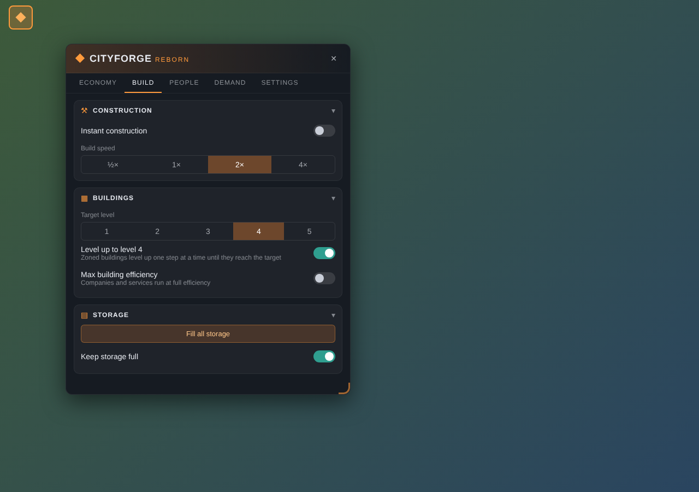

# CityForge Reborn

A cheat and sandbox panel for **Cities: Skylines II**.
Click the **◆** button in the top-left corner of the game to open it.

 

*Panel preview with sample numbers.*

## About "Reborn"

This is a brand-new mod inspired by the original CityForge.
It is not made by, or connected to, the original author, and it contains none of the original's code.
Everything was rewritten from the ground up. Please send bugs and feedback here, not to the original mod.

CityForge Reborn is fully open source under the GPL-3.0 license, and it will always stay that way.

## What it does

**Economy**
- Add or remove money, or turn on infinite money
- Jump to any milestone, or unlock them all
- Get development tree points

**Build**
- Instant construction, or build at ½× to 4× speed
- Level up buildings, max out efficiency
- Fill all storage, or keep it full
- Unlimited water and electricity
- No pollution

**People**
- Boost move-ins and tourists (up to 10×)
- Max happiness, rich citizens, max education
- Set your own education mix

**Demand**
- Set demand for each zone yourself
- **Force Build**: buildings spawn even with no demand or a poor lot

**Settings**
- Change the panel colour
- Turn all cheats off when you load a city
- Keep achievements on while using mods (in the game's Options menu)

## Install

**Paradox Mods:** subscribe on the [mod page](https://mods.paradoxplaza.com/mods/164900/Windows) or in the game's mod menu.

**Manual:** download the zip from [Releases](../../releases) and unzip it into:
```
%USERPROFILE%\AppData\LocalLow\Colossal Order\Cities Skylines II\Mods\
```
You should end up with a `Mods\CityForgeReborn` folder.

## Problems?

Open an [issue](../../issues) and attach this log file:
```
%USERPROFILE%\AppData\LocalLow\Colossal Order\Cities Skylines II\Logs\CityForgeReborn.Mod.log
```

## Roadmap

*No particular order.*

- [x] Unlimited water and electricity
- [x] No pollution
- [ ] Translations
- [ ] Time of day and weather control
- [ ] Instant garbage, crime and fire cleanup
- [ ] Unlimited healthcare and education capacity
- [ ] Max land value
- [ ] Free building upkeep
- [ ] Traffic tools: remove stuck vehicles, no accidents
- [ ] Disasters on/off
- [ ] Hotkey to open the panel
- [ ] Save and load cheat presets
- [ ] Status bar showing active cheats
- [ ] Lock the achievements option while a city is loaded
- [ ] Smoother instant construction on big builds
- [ ] Retry saving settings if another mod is saving

## Build it yourself

1. In the game, go to *Options → Modding → Install*, then restart your PC.
2. Run:
   ```
   dotnet build src/CityForgeReborn/CityForgeReborn.csproj -c Release
   ```
   This builds the mod and copies it into your Mods folder.

If the build says *"You must install or update .NET"*, install the
[.NET 6 runtime](https://dotnet.microsoft.com/download/dotnet/6.0). The game's tools need it.

Changes are listed in [CHANGELOG.md](CHANGELOG.md).

## License

GPL-3.0. Written from scratch; no code from the original CityForge mod.
