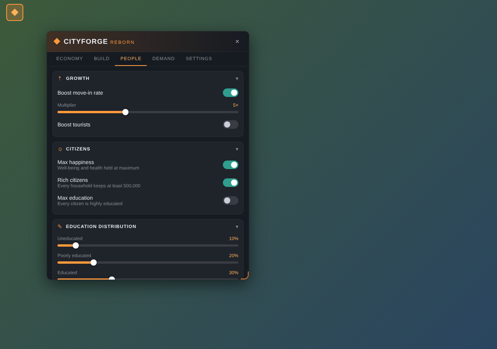
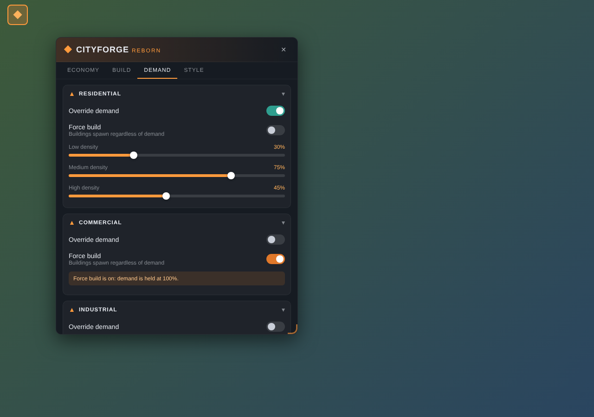

# CityForge Reborn

An all-in-one cheat / sandbox panel for **Cities: Skylines II**, written from scratch.

 
 

*(Browser preview with mocked game data.)*

## Status — v0.2.0 (untested in-game)

| Feature | State |
| --- | --- |
| Panel: toolbar button, drag, resize, tabs, collapsible cards | ✅ |
| Money: ±100K / 1M / 10M / 50M, infinite money | ✅ |
| Milestones: advance to target, unlock all, keep unlocked | ✅ |
| Development tree points | ✅ |
| Instant construction, build speed ½× / 1× / 2× / 4× | ✅ |
| Demand overrides per zone + Force Build | ✅ |
| Panel colour presets + custom hex | ✅ |
| Move-in & tourist boost (2–10×) | ✅ |
| Max happiness, rich citizens, max education, education distribution | ✅ |
| Level buildings up to a target level (1–5), max building efficiency | ✅ |
| Fill storage / keep storage full | ✅ |
| Keep achievements enabled (Options menu) | ✅ |
| Reset cheats on load | ✅ |
| Translations | ⏳ later |

See [FEATURES.md](FEATURES.md) for the full planned feature list.

## Building

You need a Windows PC with Cities: Skylines II.

1. **Install the modding toolchain** — in the game: *Options → Modding → Install*.
   This installs .NET, Node.js and sets the `CSII_*` environment variables. Restart your PC afterwards.
2. **Build:**
   ```
   dotnet build src/CityForgeReborn/CityForgeReborn.csproj -c Release
   ```
   or open `src/CityForgeReborn/CityForgeReborn.csproj` in Visual Studio 2022 and press *Build*.

   This compiles the C# mod **and** the in-game panel, and copies both into
   `%LOCALAPPDATA%Low\Colossal Order\Cities Skylines II\Mods\CityForgeReborn`.
3. Start the game, enable the mod, load a city and click the **◆** button in the top-left corner.

Logs are written to `%LOCALAPPDATA%Low\Colossal Order\Cities Skylines II\Logs\CityForgeReborn.Mod.log`.

### UI only

```
cd src/CityForgeReborn/UI
npm install
npm run build      # or: npm run dev  (rebuilds on save)
```

## Project layout

```
src/CityForgeReborn/
  Mod.cs                      entry point, registers systems
  Setting.cs                  options menu + saved cheat state
  Systems/
    CityForgeUISystem.cs      bindings between the panel and the game
    MoneyCheatSystem.cs
    MilestoneCheatSystem.cs   milestones + development points
    ConstructionCheatSystem.cs
    DemandOverrideSystem.cs
    CitizenCheatSystem.cs     happiness, education, rich households
    PopulationBoostSystem.cs  move-in / tourist multiplier
    BuildingCheatSystem.cs    level up, efficiency, storage
    AchievementSystem.cs
  UI/                         React/TypeScript panel
```

## Notes for testing

The C# has been syntax-checked against stand-in declarations, but not yet compiled
against the real game. If something doesn't compile, the most likely culprits are
game type/field names that need checking with a decompiler (ILSpy/dnSpy on `Game.dll`):

- `MilestoneData.m_XpRequried`, `XP.m_XP`, `MilestoneLevel.m_AchievedMilestone`, `DevTreePoints.m_Points`
- `UnderConstruction.m_Progress`
- `Citizen.m_WellBeing`, `Citizen.m_Health`, `Citizen.SetEducationLevel`
- `BuildingCondition.m_Condition`, `SpawnableBuildingData.m_Level`, `Efficiency.m_Efficiency`
- `StorageCompanyData.m_StoredResources`, `StorageLimitData.m_Limit`
- `PlatformManager.achievementsEnabled` (`Colossal.PSI.Common`)
- Move-in/tourist boost looks up `HouseholdSpawnSystem` / `TouristSpawnSystem` by name and logs if they're missing.
- Force Build: `ForceBuildSystem` runs the game's zone spawner an extra time with its
  `debugFastSpawn` flag on (skips demand and suitability checks), with non-forced zones
  blocked for that run. It logs a warning and falls back to 100% demand if the flag is missing.
- Demand: `DemandOverrideSystem` finds the demand systems' fields by name at runtime and
  logs which ones it found — check the log if demand overrides don't seem to work.

## License

GPL-3.0 — see [LICENSE](LICENSE). This is an independent implementation; it contains no code from the original CityForge mod.
